<samp>

## 01 · Player Profile

I'm a software engineer who builds high-performance, human-friendly interfaces in **C++** and **Qt**. I started at TATA Advanced Systems, where I rebuilt the HMI of an electronic-warfare system and prototyped a 3D simulator for real-time sensor data. At Delta IoT I wrote embedded display software for a global agricultural-equipment OEM.

Today I'm a Software Engineer II at Bentley Systems in Pune, working on infrastructure engineering software and digital twins. Off the clock I build my own Windows tools in Qt 6 and QML, and play a lot of video games, which is probably why I care so much about how software feels in the hand.

## 02 · Quest Log

Three campaigns so far. Open one to read its objectives.

<b>Bentley Systems</b> · Software Engineer II · Sep 2026 – Present · <kbd>MAIN QUEST</kbd>

- Developing and debugging C++ application software in the infrastructure engineering and digital twin domain.
- Quest in progress. More objectives unlock as they ship.

Loot: `C++` `Infrastructure engineering software` `Digital twins`

<b>Delta IoT Solutions</b> · Senior C++ Developer · Feb 2025 – Sep 2026

- Developed embedded display software for a global agricultural-equipment OEM.
- Brought GenAI into the development workflow to design and maintain automation scripts, cutting manual effort by ~90%.
- Built an integration platform that runs system health checks and prevents unplanned downtime, saving ~$200K a year.

Loot: `C++` `Embedded displays` `GenAI automation` `Code reviews`

<b>TATA Advanced Systems</b> · Trainee to Senior Executive · Oct 2021 – Feb 2025

- Overhauled the HMI of an electronic-warfare system in Qt 5, raising usability and performance by ~80%.
- Built a 3D simulator prototype that visualises real-time sensor data, with interactive Three.js scenes.
- Cut HMI load time by ~45% with multithreading, and task-creation load times by ~65%.
- Four performance-based promotions in 3.5 years.

Loot: `C++` `Qt 5` `Three.js` `JavaScript` `gSOAP` `OpenDDS` `MySQL` `Multithreading`

## 03 · Side Quests

What I build when nobody is assigning tickets.

| Quest | What it is | Built with |
| --- | --- | --- |
| [MediaFlyouts](https://github.com/lalitmeena04/MediaFlyouts) | Fluent-styled flyouts and taskbar widgets for Windows: media, volume, lock keys and peripheral battery. On the Microsoft Store. | C++, Qt 6, QML |
| [AULA F75 Studio](https://github.com/lalitmeena04/AULA-F75-Studio) | Open-source companion app and alternative driver for the AULA F75 mechanical keyboard. | C++, Qt 6, QML |
| [LEET](https://github.com/lalitmeena04/leet) | Lecture Engagement Evaluation Tool: an Electron dashboard over a Flask face-analysis pipeline. | Vue 2, Python |
| [Workflow Analyzer](https://github.com/lalitmeena04/workflow-analyzer) | Turns a team's Outlook mail into live progress charts. College project from 2019. | PHP, Flask, Vue 2 |

## 04 · Free Roam

What I do between quests: `Gaming` `Football` `Chess` `Anime` `Manga`

Favourite games: NFS Most Wanted (2005), FIFA, Valorant, Fortnite, Apex Legends, Assassin's Creed, GTA, Call of Duty and Battlefield.

## 05 · Player 2, press start

Have a role, a project, or a game recommendation? Find me on [LinkedIn](https://www.linkedin.com/in/lalitmeena).

This page is only the title screen. The full game is my <a href="https://github.com/lalitmeena04/personal-portfolio">portfolio</a>: a Vue 3 and Three.js site with a quest log and a playable mini-game for every hobby. Still in development.

</samp>
